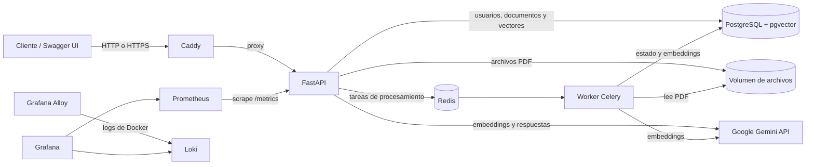
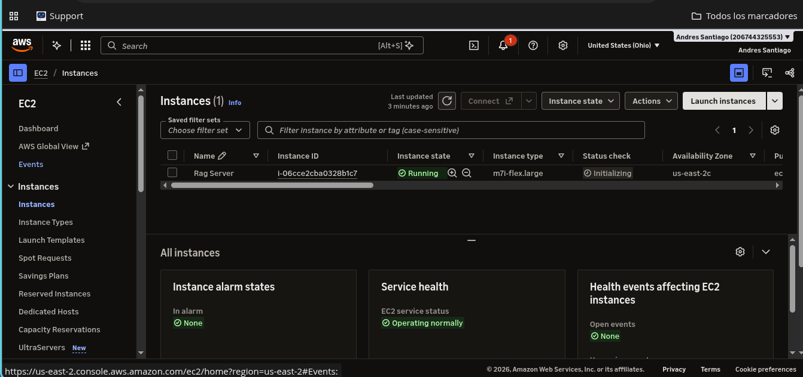
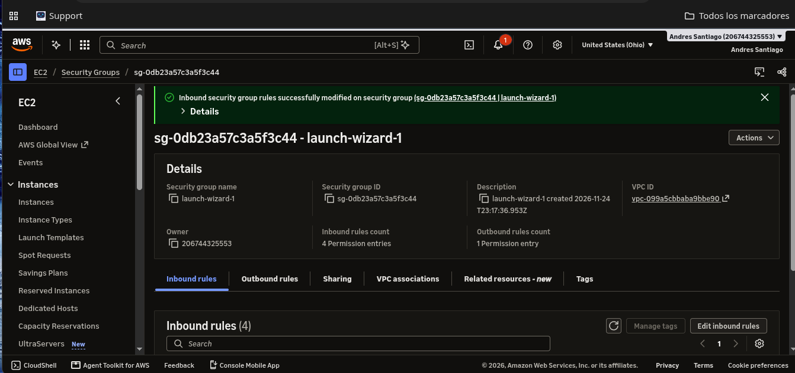
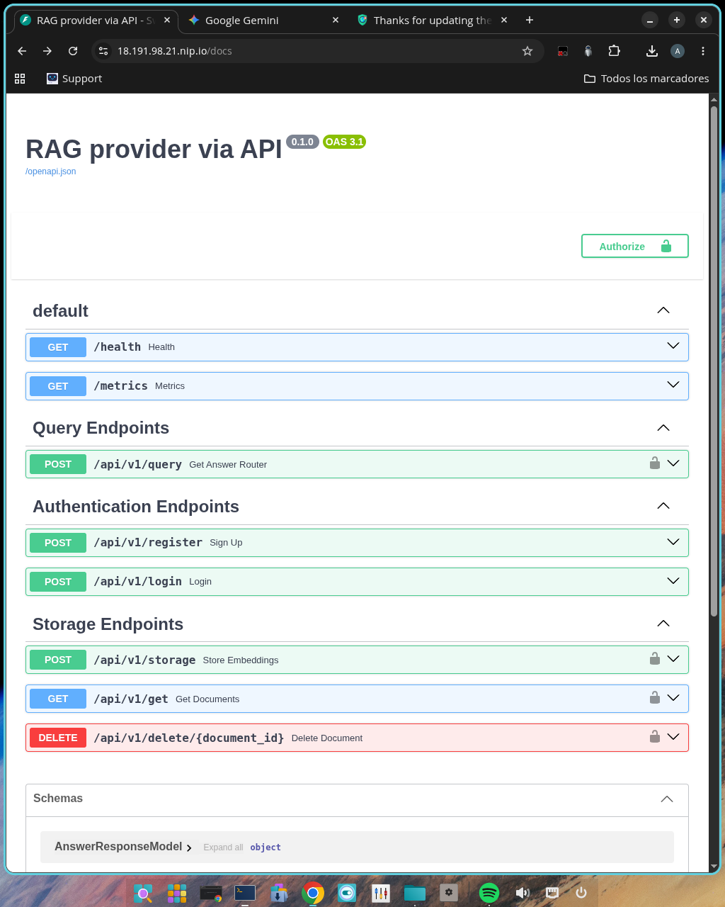
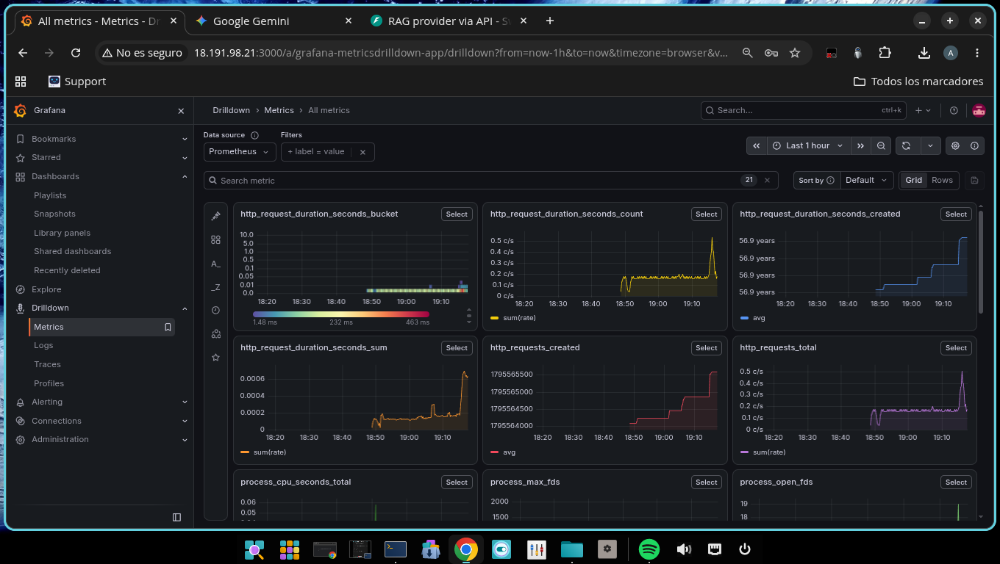
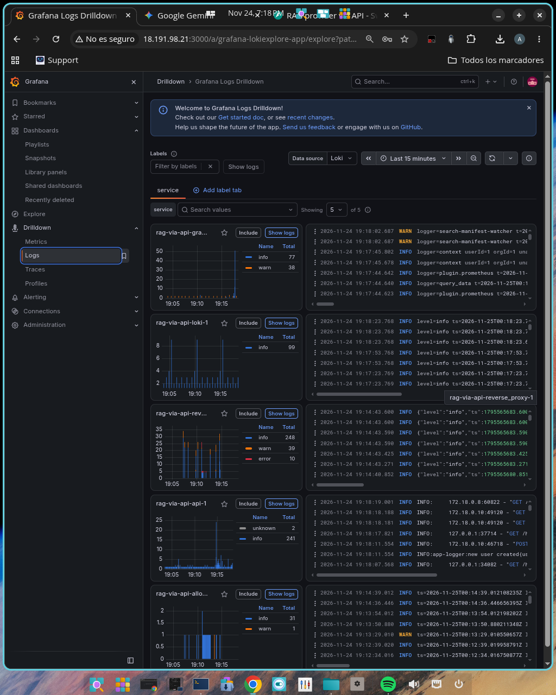

# RAG provider via API

API de **Retrieval-Augmented Generation (RAG)** para cargar documentos PDF y hacer preguntas sobre su contenido. La aplicación extrae y fragmenta el texto, genera embeddings con Google Gemini, guarda los vectores en PostgreSQL con pgvector y recupera contexto relevante para construir respuestas.

El proyecto incluye autenticación, procesamiento asíncrono, despliegue con Docker Compose y observabilidad con Prometheus, Grafana, Loki y Grafana Alloy. También cuenta con evidencia de despliegue en una instancia **Amazon EC2**.

> **Alcance:** es una implementación funcional y desplegable, no una garantía de preparación para producción sin configuración adicional. Revisa las limitaciones y recomendaciones de seguridad antes de exponerla públicamente.

## Contenido

- [Características](#características)
- [Arquitectura](#arquitectura)
- [Tecnologías](#tecnologías)
- [Ejecución con Docker Compose](#ejecución-con-docker-compose)
- [Despliegue en AWS EC2](#despliegue-en-aws-ec2)
- [API](#api)
- [Observabilidad](#observabilidad)
- [Pruebas](#pruebas)
- [Datos y privacidad](#datos-y-privacidad)
- [Limitaciones y siguientes pasos](#limitaciones-y-siguientes-pasos)
- [Estructura](#estructura)
- [Licencia](#licencia)

## Características

- Registro e inicio de sesión con tokens bearer JWT.
- Carga, listado y eliminación de documentos PDF por usuario.
- Procesamiento de PDF fuera de la petición HTTP mediante Celery y Redis.
- Extracción de texto, fragmentación en bloques de 500 caracteres con 50 caracteres de solapamiento y generación de embeddings.
- Búsqueda semántica con pgvector, limitada a los documentos del usuario autenticado.
- Preguntas sobre todos los documentos del usuario o sobre un documento elegido.
- Migraciones de esquema con Alembic.
- Endpoint de salud y métricas Prometheus.
- Recolección centralizada de logs de contenedores con Alloy y Loki.
- Interfaz de Grafana con orígenes Prometheus y Loki provisionados.

## Arquitectura



### Flujo de un documento

1. El usuario se registra o inicia sesión y obtiene un token JWT.
2. La API recibe el PDF, guarda el archivo en el volumen local y crea un registro con estado `pending`.
3. La API encola una tarea en Redis; un worker Celery la procesa de forma asíncrona.
4. El worker extrae el texto del PDF, lo divide en bloques y solicita embeddings a Gemini.
5. Los bloques y vectores se guardan en pgvector; el documento pasa a `processed`. Si falla el procesamiento, queda en `failed`.
6. Para una consulta, la API genera un embedding de la pregunta, recupera contexto del usuario en pgvector y solicita a Gemini una respuesta basada en ese contexto.

### Estados de documento

| Estado | Significado |
|---|---|
| `pending` | El archivo se guardó y espera procesamiento. |
| `processed` | El texto y los embeddings se procesaron correctamente. |
| `failed` | El procesamiento no pudo completarse. |

El modelo de dominio también define `processing`, pero el worker actual no persiste ese estado durante la ejecución.

## Tecnologías

| Componente | Tecnología |
|---|---|
| API y documentación interactiva | FastAPI, Uvicorn, Swagger UI |
| Persistencia relacional y vectorial | PostgreSQL 15, pgvector, SQLAlchemy |
| Migraciones | Alembic |
| Autenticación | OAuth2 password flow, JWT, hash de contraseñas con Argon2 |
| Embeddings y generación | Google Gemini (`gemini-embedding-001`, `gemini-3.5-flash-lite`) |
| Procesamiento en segundo plano | Celery, Redis 7 |
| Lectura de PDF | pypdf |
| Proxy inverso | Caddy 2 |
| Métricas | prometheus-client, Prometheus |
| Logs | Grafana Alloy, Loki |
| Visualización | Grafana |
| Ejecución | Docker, Docker Compose |

## Requisitos

- Docker Engine y Docker Compose v2.
- Una clave de API válida para Google Gemini.
- Para acceder desde Internet: una instancia EC2, reglas de red apropiadas y, para HTTPS automático de Caddy, un dominio que apunte a la instancia.

## Ejecución con Docker Compose

### 1. Configurar el entorno

Desde la raíz del repositorio, crea un archivo `.env` (está excluido de Git) con valores propios:

```dotenv
POSTGRES_USER=rag_user
POSTGRES_PASSWORD=reemplazar-por-una-clave-segura
SECRET_KEY=reemplazar-por-un-secreto-aleatorio
API_KEY=tu-clave-de-google-gemini
GF_SECURITY_ADMIN_USER=admin
GF_SECURITY_ADMIN_PASSWORD=reemplazar-por-una-clave-segura
BASE_PATH=/app/storage
```

Genera un secreto JWT robusto localmente, por ejemplo:

```bash
python -c 'import secrets; print(secrets.token_urlsafe(48))'
```

En un host Linux, limita el acceso al archivo:

```bash
chmod 600 .env
```

`DATABASE_URL` y `REDIS_URL` se construyen internamente en `docker-compose.yml`. No subas `.env`, claves de Gemini, contraseñas ni tokens al repositorio.

### 2. Iniciar los servicios

```bash
docker compose up --build -d
docker compose ps
```

Compose inicia PostgreSQL con pgvector, Redis, las migraciones, la API, el worker Celery, Caddy, Prometheus, Loki, Alloy y Grafana. Las migraciones se ejecutan antes de que la API y el worker queden disponibles.

### 3. Comprobar la aplicación

La configuración local actual de Caddy usa `localhost`:

- API y Swagger UI: <http://localhost/docs>
- OpenAPI JSON: <http://localhost/openapi.json>
- Salud: <http://localhost/health>
- Métricas: <http://localhost/metrics>
- Grafana: <http://localhost:3000>

Prometheus, Loki, Redis y PostgreSQL no publican puertos en el host en la configuración Compose incluida.

Comandos útiles:

```bash
docker compose logs -f api worker
docker compose logs -f prometheus grafana loki alloy
docker compose ps
docker compose down
```

`docker compose down` conserva los volúmenes. **No uses `docker compose down -v` salvo que quieras eliminar también los datos persistidos** (base de datos, archivos, Redis, Grafana y datos de Caddy).

## Despliegue en AWS EC2

Este proyecto fue desplegado en una instancia EC2. Las capturas siguientes documentan la instancia y su configuración de red; no representan una garantía de disponibilidad continua ni publican una URL de servicio estable.

### Evidencia del despliegue

**Instancia EC2:**



**Configuración del grupo de seguridad:**



**Swagger UI de la API desplegada:**



> La captura de terminal disponible en `docs/images/sshconectionviaterminal.png` no se incluye aquí: contiene credenciales de despliegue visibles. Antes de compartir o versionar esa imagen, revoca las credenciales expuestas y reemplázala por una copia correctamente censurada.

### Pasos para desplegar una instancia propia

1. **Crea una instancia EC2** con una distribución Linux compatible con Docker (por ejemplo, Ubuntu LTS) y almacenamiento suficiente para imágenes, base de datos y documentos. Para conservar una dirección estable, asocia una Elastic IP.
2. **Configura el grupo de seguridad** siguiendo el principio de mínimo acceso:
   - SSH (TCP `22`): solo desde tu IP o red administrativa.
   - HTTP/HTTPS (TCP `80`/`443`): desde Internet si la aplicación será pública y se usará un dominio.
   - Grafana (TCP `3000`): no lo abras públicamente; limita el origen a una IP administrativa o accede por túnel SSH.
   - No abras al público los puertos de PostgreSQL, Redis, Prometheus ni el puerto interno de FastAPI (`8000`).
3. **Instala Docker Engine y el plugin Docker Compose v2** siguiendo la documentación oficial de Docker para la distribución elegida. Conéctate por SSH y clona el repositorio:

   ```bash
   git clone https://github.com/AndresPimentel-dev/RAG-via-api.git
   cd RAG-via-api
   ```

4. **Configura `.env`** como se describe en [Ejecución con Docker Compose](#ejecución-con-docker-compose). Usa valores únicos y fuertes; no reutilices credenciales de desarrollo ni incluyas el archivo en Git.
5. **Configura el dominio antes de iniciar Caddy.** Crea un registro DNS `A` que apunte a la IP pública/Elastic IP de la instancia y cambia el bloque `localhost` de `caddyfile` por tu dominio, por ejemplo:

   ```caddyfile
   rag.ejemplo.com {
       reverse_proxy api:8000
   }
   ```

   Caddy puede gestionar HTTPS automáticamente cuando el dominio resuelve a la instancia y los puertos `80` y `443` son accesibles. Sin dominio, no asumas que `localhost` servirá la API públicamente ni que habrá un certificado HTTPS válido.
6. **Inicia y verifica los contenedores:**

   ```bash
   docker compose up --build -d
   docker compose ps
   docker compose logs --tail=100 api worker migrations
   ```

7. **Valida desde tu equipo** el endpoint `/health` y la documentación `/docs` usando tu dominio. Para acceder a Grafana sin exponer el puerto `3000`, crea un túnel SSH:

   ```bash
   ssh -L 3000:127.0.0.1:3000 usuario@IP_PUBLICA_EC2
   ```

   Abre <http://localhost:3000> e inicia sesión con las credenciales configuradas en `GF_SECURITY_ADMIN_USER` y `GF_SECURITY_ADMIN_PASSWORD`.

Para actualizar una instalación existente, revisa los cambios y ejecuta `git pull` seguido de `docker compose up --build -d`. Haz respaldos antes de actualizar la base de datos o cambiar la instancia. Los volúmenes Docker residen en el disco de la instancia y **no sustituyen un respaldo externo**.

## API

La documentación interactiva generada por FastAPI está disponible en `/docs`; también se publica `/openapi.json`. Los endpoints de negocio usan el prefijo `/api/v1`.

### Endpoints

| Método | Ruta | Autenticación | Descripción |
|---|---|---:|---|
| `GET` | `/health` | No | Comprueba que la API responde. |
| `GET` | `/metrics` | No | Expone métricas en formato Prometheus. |
| `POST` | `/api/v1/register` | No | Crea una cuenta y devuelve un token. |
| `POST` | `/api/v1/login` | No | Inicia sesión y devuelve un token. |
| `POST` | `/api/v1/storage` | Bearer | Carga un PDF y encola su procesamiento. |
| `GET` | `/api/v1/get` | Bearer | Lista los documentos del usuario autenticado. |
| `DELETE` | `/api/v1/delete/{document_id}` | Bearer | Elimina un documento del usuario y sus vectores. |
| `POST` | `/api/v1/query` | Bearer | Consulta el contexto indexado del usuario. |

### Autenticación

El registro recibe JSON:

```json
{
  "username": "ana",
  "email": "ana@example.com",
  "password": "una-clave-segura"
}
```

El login usa `application/x-www-form-urlencoded`, con los campos `username` y `password`:

```bash
curl -X POST http://localhost/api/v1/login \
  -H 'Content-Type: application/x-www-form-urlencoded' \
  --data-urlencode 'username=ana' \
  --data-urlencode 'password=TU_CLAVE'
```

Ambos endpoints devuelven un `access_token` de tipo `bearer`. El token dura 30 minutos por defecto; la configuración actual no ofrece refresh tokens.

### Cargar y consultar documentos

Usa el token recibido al autenticarte:

```bash
export TOKEN='PEGA_AQUI_EL_ACCESS_TOKEN'

curl -X POST http://localhost/api/v1/storage \
  -H "Authorization: Bearer $TOKEN" \
  -F 'file=@./documento.pdf;type=application/pdf'
```

La carga responde con los datos del documento y su estado inicial `pending`. El procesamiento es asíncrono; consulta `GET /api/v1/get` para revisar el estado.

Consulta todos los documentos procesados del usuario:

```bash
curl -X POST http://localhost/api/v1/query \
  -H "Authorization: Bearer $TOKEN" \
  -H 'Content-Type: application/json' \
  -d '{"request":"¿Cuál es el tema principal del documento?"}'
```

Para limitar la búsqueda a un documento, incluye su `file_id`:

```json
{
  "request": "¿Cuáles son las condiciones indicadas?",
  "file_id": 1
}
```

Las respuestas tienen el formato `{"answer": "..."}`. Si no existe contexto relevante, la API devuelve un error de contexto no encontrado, no una respuesta generada sin documentos.

## Observabilidad

### Métricas

Prometheus consulta `api:8000/metrics` cada 15 segundos en la red interna de Docker. La API expone métricas HTTP y de operaciones/latencia/errores del ORM. El worker también instrumenta duración, resultados y errores de tareas Celery, pero el `prometheus.yml` actual solo configura el scrape de la API; por ello, las métricas internas del worker no quedan disponibles en Prometheus con la configuración incluida. Grafana tiene Prometheus provisionado como origen de datos.



### Logs

Grafana Alloy descubre contenedores Docker y envía sus logs a Loki. Grafana tiene Loki provisionado como segundo origen de datos.



Grafana se publica en el puerto `3000` del host según el Compose actual. Restringe ese puerto en el grupo de seguridad de AWS y protege las credenciales de administrador.

## Pruebas

El archivo de Compose de pruebas configura PostgreSQL y Redis aislados; la suite comprueba que `DATABASE_URL` contenga `test` o `prueba` para reducir el riesgo de ejecutar pruebas contra una base de datos incorrecta.

Con Docker Compose v2:

```bash
docker compose -f docker-compose.test.yml up --build --abort-on-container-exit tests_container
docker compose -f docker-compose.test.yml down
```

El contenedor de pruebas ejecuta `pytest`, `ruff check` y `ruff format --check`.

## Datos y privacidad

- Los PDF se guardan en el sistema de archivos local bajo `BASE_PATH` y los metadatos/embeddings en PostgreSQL. En Compose, ambos servicios usan volúmenes persistentes.
- El procesamiento envía el texto extraído a Google Gemini para generar embeddings. Las consultas también envían la pregunta y el contexto recuperado al modelo para generar la respuesta. Revisa las condiciones y políticas aplicables antes de cargar información sensible.
- La búsqueda y las operaciones de documentos se acotan al usuario autenticado.
- El volumen de almacenamiento local no es un sistema de objetos compartido: varias réplicas de API/workers requerirían almacenamiento compartido o un adaptador de objetos y una estrategia consistente de acceso.
- La carga valida el tipo MIME declarado como `application/pdf`; esta comprobación por sí sola no verifica el contenido real del archivo.
- La API expone `/metrics` sin autenticación. Si se publica fuera de la red privada, restringe su acceso en el proxy o en la capa de red.

## Limitaciones y siguientes pasos

Antes de usar el servicio en producción, evalúa al menos:

- Límites de tamaño, número de páginas y tiempo de procesamiento para los PDF.
- OCR para documentos escaneados; la extracción actual depende del texto disponible en el PDF.
- Reintentos, backoff y recuperación de tareas Celery fallidas.
- Almacenamiento de objetos duradero si se necesitan varias instancias o recuperación ante pérdida de la EC2.
- Backups verificados de PostgreSQL y procedimientos de restauración.
- Control de acceso a Grafana y `/metrics`, además de políticas de firewall de mínimo privilegio.
- Gestión, rotación y almacenamiento seguro de secretos y claves de API.
- Rate limiting, cuotas por usuario y políticas de retención/eliminación de documentos.

## Estructura

```text
.
├── src/
│   ├── domain/             # Entidades, interfaces, excepciones y enums
│   ├── use_cases/          # Flujos de autenticación, documentos y consultas
│   └── infrastructure/     # API, base de datos, Celery, Gemini y observabilidad
├── test/
│   ├── unit/
│   └── integration/
├── alembic/                # Migraciones de base de datos
├── docs/images/            # Capturas de EC2, API, métricas y logs
├── grafana/provisioning/   # Orígenes de datos de Grafana
├── loki/                   # Configuración de Loki
├── alloy/                  # Recolección de logs Docker
├── Dockerfile
├── docker-compose.yml
├── docker-compose.test.yml
├── prometheus.yml
├── caddyfile
└── requirements.txt
```

## Licencia

Consulta el archivo [LICENSE](LICENSE) para los términos de uso.